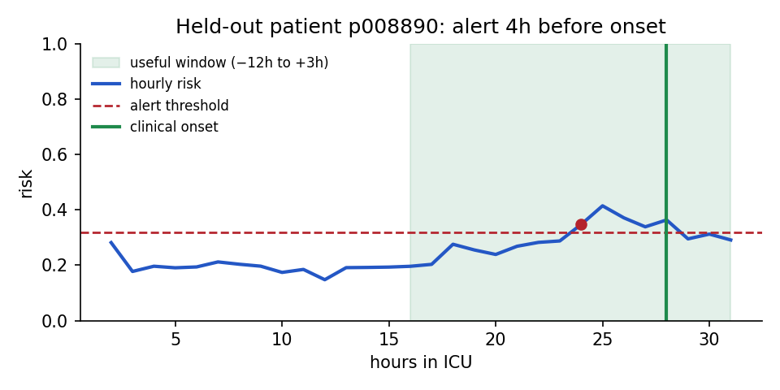
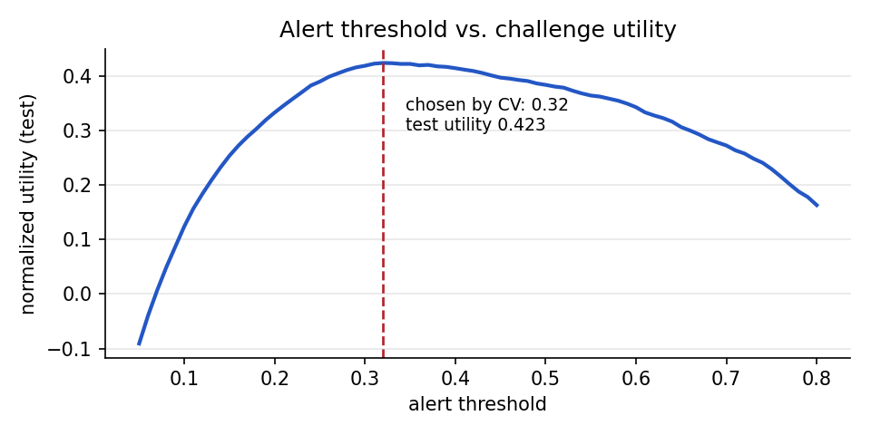

# Sepsis Early Warning

[](https://github.com/ShawnJoshua03/sepsis-early-warning/actions/workflows/ci.yml)
[](https://shawnjoshua03.github.io/sepsis-early-warning/)
[](LICENSE)

An hourly ICU early-warning model that flags patients up to 12 hours before
sepsis onset, using routine vitals and labs. It is trained on real PhysioNet
2019 Challenge data and scored with the Challenge's official clinical utility
metric.

**[Try the live demo →](https://shawnjoshua03.github.io/sepsis-early-warning/)**
It replays real held-out patients hour by hour and shows when the alert would
have fired.



## Results

Evaluated on **4,441 held-out patients** (patient-level split, never seen in
training). The alert threshold was chosen by cross-validation on the training
patients only.

| Metric | Value |
|---|---|
| Normalized utility (official Challenge metric) | **0.424** |
| AUROC / AUPRC (hourly) | 0.817 / 0.092 |
| Septic patients flagged in the useful window (−12h to +3h of onset) | 370 / 398 (93%) |
| Median warning before onset, among those flagged | 12 h |
| Non-septic patients with at least one alarm | 2,381 / 4,043 (59%) |
| Septic patients who also alarmed *before* the useful window | 271 / 398 (68%) |

The last two rows are the cost of the high detection rate. Read them with the
limitations below.



The threshold picked by cross-validation (0.32) lands at the peak of the test
curve, so the tuning generalized instead of overfitting.

## How it works

```
per-patient .psv files (one row per ICU hour)
  -> src/load.py       read the Challenge folder structure
  -> src/features.py   causal time-series features (no future leakage)
  -> src/train.py      patient-grouped split, CV-tuned alert threshold
  -> src/evaluate.py   official utility + AUROC/AUPRC + windowed lead time
  -> src/app.py        FastAPI scorer + demo page (one risk score per hour)
```

**Design decisions**

- **The official metric, not a proxy.** `src/sepsis_utility.py` vendors the
  Challenge's own `compute_prediction_utility`. It rewards alerts 6–12h before
  onset, penalizes late or missed cases heavily, and charges a small cost for
  every false alarm, which is how the trade-off between catching sepsis and
  alert fatigue plays out at the bedside.
- **Causal features, tested.** Every feature at hour *t* uses only data up to
  *t*: forward-fills, rolling and expanding windows. `tests/test_features.py`
  checks this directly: appending or corrupting future hours must leave every
  earlier feature unchanged.
- **Missingness as signal.** Labs are drawn sparsely, and *when* a clinician
  orders one is informative. Each channel gets a "measured this hour" flag and
  an "hours since last measured" feature.
- **Patient-grouped splits everywhere.** The train/test split and the CV folds
  are both by patient, so hours from one stay never land on both sides.
- **Threshold tuned out-of-fold.** Tuning on the final model's own training
  predictions picks a threshold for overconfident scores. In-sample utility is
  0.67 versus 0.42 on test, so the threshold is tuned on 3-fold out-of-fold
  predictions instead.
- **Honest lead time.** An alarm fired 30 hours before onset doesn't count as
  early detection. It fired before anything predictive was observable. Lead
  time only counts alerts inside the window the metric rewards, and earlier
  alarms are reported separately.

## Limitations

- **High alarm burden.** At the utility-optimal threshold, most non-septic
  patients alarm at least once during their stay. The utility metric charges
  only 0.05 per false-positive hour, so it tolerates this, but a deployment
  would need alert suppression or a stricter threshold.
- **Not comparable to the Challenge leaderboard.** The best official entries
  scored about 0.36. That was on hidden test sets that included a hospital no
  team had data from. This result is an internal split of a single hospital
  system, which is a much easier setting.
- **Partial training data.** Trained on 17,762 of the 20,336 patients in
  training set A. Training set B (the second hospital) was not used. Training
  on A and testing on B would be the honest external-validation experiment.
- **A strong baseline, not the state of the art.** Leading approaches add
  sequence models and per-hospital calibration. Probabilities here are not
  calibrated.
- **Research demo only.** Not a medical device, and not validated for clinical
  use.

## Run it locally

```bash
pip install -r requirements-dev.txt
export PYTHONPATH=src            # PowerShell: $env:PYTHONPATH="src"

uvicorn app:app --app-dir src --reload   # demo at http://localhost:8000
pytest -q                                # causality, metric and API tests
```

The trained model (`artifacts/model.joblib`) is committed, so the demo works
out of the box.

### Reproduce the results

Download the Challenge training data (open access, CC BY 4.0) from
<https://physionet.org/content/challenge-2019/1.0.0/>, then:

```bash
python src/train.py --data training_setA    # trains, tunes threshold (~15 min)
python src/evaluate.py                      # utility + lead-time report
python scripts/export_demo.py               # pick held-out demo patients
python scripts/make_figures.py              # README figures
```

To try the pipeline without downloading anything, run
`python data/make_sample.py` and `python src/train.py`. These generate and
train on synthetic patients in the real schema. Scores on synthetic data are
near-perfect and mean nothing.

## API

`POST /score` takes one patient's hourly rows using the Challenge column
names. Interactive docs are at `/docs`.

```bash
curl -X POST localhost:8000/score -H "Content-Type: application/json" \
  -d '{"records": [{"ICULOS": 1, "HR": 92, "Temp": 38.4, "Resp": 24},
                   {"ICULOS": 2, "HR": 104, "MAP": 63, "Lactate": 2.9}]}'
```

The response contains `hourly_risk`, the `threshold`, `first_alert_hour` and a
recommendation. Validation rules:

- `ICULOS` is required, must be an integer ≥ 1, and must be unique per row.
- All measurements are optional.
- Unknown fields are rejected (422), so a typo like `"hr"` can't silently be
  scored as "never measured".
- Duplicate hours and empty or oversized payloads are rejected.

## Deploy

CI runs the tests and a Docker smoke test on every push to `main`. If they
pass, `.github/workflows/pages.yml` publishes the demo to **GitHub Pages**.
It's free and always on, with no server to wake up.

The Pages demo is static. At build time, `scripts/build_pages.py` sends each
demo patient through the real `/score` endpoint and saves the responses next
to the page. Every number shown therefore comes from the committed model,
through the same validation and feature code as the live API. The page calls
the live API only when no saved scores are present, which is the case when you
run it locally.

To host the **live API** as well, deploy the Dockerfile to any container host
that sets `$PORT`, such as Render, Fly.io or Cloud Run. It's a standard
uvicorn image that runs as a non-root user.

The demo only replays bundled, de-identified Challenge patients and stores
nothing. Don't put a deployment like this in front of real patient data: that
needs authentication, audit logging and a hospital-controlled network.

## Layout

```
src/config.py           exact 40-column Challenge schema
src/load.py             read per-patient .psv files
src/features.py         causal time-series feature engineering
src/train.py            training, CV threshold tuning, artifacts
src/evaluate.py         official utility + windowed lead-time report
src/sepsis_utility.py   vendored official metric (see NOTICE.md)
src/app.py              FastAPI scorer + demo page
src/static/             demo page and 7 held-out demo patients
scripts/                demo-patient export, README figures, Pages build
tests/                  causality, metric and API tests
data/make_sample.py     synthetic sample in the real schema
```

## Data and citation

PhysioNet/CinC Challenge 2019 data, CC BY 4.0. Full citations and the license
for the vendored metric are in [NOTICE.md](NOTICE.md).

> Reyna MA, et al. Early Prediction of Sepsis From Clinical Data: The
> PhysioNet/Computing in Cardiology Challenge 2019. *Critical Care Medicine*
> 48(2):210–217 (2020).
