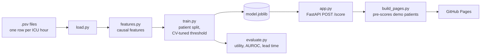

<div align="center">

# Sepsis Early Warning

**A model that scores ICU patients every hour from routine vitals and labs and tries to flag sepsis up to 12 hours before onset.**

[](https://github.com/ShawnJoshua03/sepsis-early-warning/actions/workflows/ci.yml)
[](LICENSE)


[](https://shawnjoshua03.github.io/sepsis-early-warning/)
[](https://shawnjoshua03.github.io/stories/sepsis-early-warning/)

[Live demo](https://shawnjoshua03.github.io/sepsis-early-warning/) | [Write-up](https://shawnjoshua03.github.io/stories/sepsis-early-warning/) | [Portfolio](https://shawnjoshua03.github.io/)


</div>

A model that scores ICU patients every hour from routine vitals and labs and
tries to flag sepsis up to 12 hours before onset. It's trained on the
PhysioNet 2019 Challenge data and scored with the Challenge's own utility
metric.

I wanted to build something in healthcare and learn the tools along the way.
The task, data and scoring all come from the 2019 PhysioNet/CinC Challenge
paper (Reyna et al., cited at the bottom). It was a heavy task for a laptop.
Mine kept breaking.

**[Live demo](https://shawnjoshua03.github.io/sepsis-early-warning/)**: replays
held-out patients hour by hour and shows when the alert would have fired.


## Results

4,441 held-out patients, split by patient so none of them were seen in
training. The alert threshold was picked by cross-validation on the training
patients only.

| Metric | Value |
|---|---|
| Normalized utility (official Challenge metric) | **0.424** |
| AUROC / AUPRC (hourly) | 0.817 / 0.092 |
| Septic patients flagged in the useful window (−12h to +3h of onset) | 370 / 398 (93%) |
| Median warning before onset, among those flagged | 12 h |
| Non-septic patients with at least one alarm | 2,381 / 4,043 (59%) |
| Septic patients who also alarmed *before* the useful window | 271 / 398 (68%) |

Read the last two rows before the first four. The model catches most septic
patients partly because it alarms on a lot of people. The 12h median is also
the most the window allows: many of those patients were already alarming when
the window opened.


The threshold cross-validation picked (0.32) sits at the peak of the test
curve.

## How it works



Python 3.13, pandas, scikit-learn's `HistGradientBoostingClassifier`, FastAPI,
a plain JS demo page, pytest, ruff, Docker, GitHub Actions.

Choices that matter:

- Scoring uses the Challenge's own `compute_prediction_utility`, copied
  unchanged into `src/sepsis_utility.py`. It gives the most credit for alerts
  6 to 12h before onset, penalizes late or missed cases hard, and charges 0.05
  for every false-alarm hour.
- Features at hour *t* only use data up to *t* (forward-fills, rolling and
  expanding windows). `tests/test_features.py` appends and corrupts future
  hours and checks that nothing earlier changes.
- Labs are sparse, and when one gets ordered says something. Each channel has
  a "measured this hour" flag and an "hours since last measured" count.
- Train/test and the CV folds are both split by patient, so one stay never
  ends up on both sides.
- The threshold is tuned on 3-fold out-of-fold predictions. Tuning on the
  final model's own training scores would be tuning on overconfident numbers:
  in-sample utility is 0.67 against 0.42 on test.
- Lead time only counts alerts inside the window the metric rewards. An alarm
  30 hours before onset usually fired at admission, before anything predictive
  happened, so those are reported separately.

## Limitations

- The alarm burden is high. At the utility-optimal threshold, most non-septic
  patients alarm at least once. The metric only charges 0.05 per false-positive
  hour so it tolerates this. A real deployment would need alert suppression or
  a stricter threshold.
- Don't compare 0.424 with the Challenge leaderboard (best entries scored about
  0.36). Those were scored on hidden test sets that included a hospital no team
  had data from. This is an internal split of one hospital system, which is
  much easier.
- Trained on 17,762 of the 20,336 patients in training set A, the most my
  laptop could run without breaking down. Training set B (the second
  hospital) wasn't used. Training on A and testing on B is the
  external-validation experiment this still needs.
- It's a gradient-boosting baseline. Top entries added sequence models and
  per-hospital calibration, and the probabilities here aren't calibrated.
- Research demo only. Not a medical device and not validated for clinical use.

## Setup

```bash
make setup    # pinned dependencies
make run      # demo + API at http://localhost:8000
make test
make lint
```

Without `make` (plain Windows, for example):

```bash
pip install -r requirements-dev.txt
export PYTHONPATH=src            # PowerShell: $env:PYTHONPATH="src"
uvicorn app:app --app-dir src --reload
pytest -q
```

The trained model (`artifacts/model.joblib`) is committed, so the demo runs
without training anything.

To reproduce the results, download the Challenge training data (open access,
CC BY 4.0) from <https://physionet.org/content/challenge-2019/1.0.0/>, then:

```bash
python src/train.py --data training_setA    # ~15 min
python src/evaluate.py
python scripts/export_demo.py               # picks the demo patients
python scripts/make_figures.py
```

`python data/make_sample.py` followed by `python src/train.py` runs the whole
pipeline on synthetic patients in the real schema, no download needed. The
scores it prints are near-perfect and mean nothing.

## API

`POST /score` takes one patient's hourly rows with the Challenge column names.
Interactive docs are at `/docs` when running locally.

```bash
curl -X POST localhost:8000/score -H "Content-Type: application/json" \
  -d '{"records": [{"ICULOS": 1, "HR": 92, "Temp": 38.4, "Resp": 24},
                   {"ICULOS": 2, "HR": 104, "MAP": 63, "Lactate": 2.9}]}'
```

The response has `hourly_risk`, `threshold`, `first_alert_hour` and a
recommendation string. `ICULOS` is required, an integer ≥ 1 and unique per
row. Every measurement is optional. Unknown fields get a 422, so a typo like
`"hr"` can't quietly be scored as "never measured". Empty payloads and more
than 2,000 rows are rejected too.

## Deploy

The live demo is static. `scripts/build_pages.py` runs each demo patient
through the real `/score` endpoint at build time and saves the responses next
to the page, so the numbers on the site come from the committed model. CI
(ruff, tests, a Docker smoke test) has to pass on `main` before
`.github/workflows/pages.yml` publishes it.

I tried Hugging Face Spaces first, but Docker Spaces need a paid plan now. The Dockerfile still works on any host that sets `$PORT` (Render, Fly.io,
Cloud Run) if you want the live API. Don't point it at real patient data: that
needs authentication, audit logging and a hospital network.

## Layout

```
src/config.py           the 40-column Challenge schema and shared constants
src/load.py             read per-patient .psv files
src/features.py         causal feature engineering
src/train.py            training, CV threshold tuning
src/evaluate.py         utility and lead-time report
src/sepsis_utility.py   the Challenge's metric (see NOTICE.md)
src/app.py              FastAPI scorer + demo page
src/static/             demo page and 7 held-out demo patients
scripts/                demo-patient export, README figures, Pages build
tests/                  causality, metric, loader and API tests
data/make_sample.py     synthetic patients in the real schema
```

## Data and citation

PhysioNet/CinC Challenge 2019 data, CC BY 4.0. Full citations and the metric's
license are in [NOTICE.md](NOTICE.md).

> Reyna MA, et al. Early Prediction of Sepsis From Clinical Data: The
> PhysioNet/Computing in Cardiology Challenge 2019. *Critical Care Medicine*
> 48(2):210-217 (2020).
